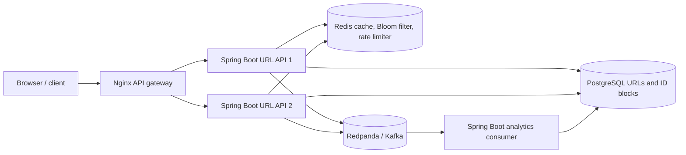

# Relay — distributed URL shortener (Java)

Relay is a Java 21 / Spring Boot URL shortener with a browser UI and a multi-service local deployment. The stack runs Nginx, two URL API instances, Redis, PostgreSQL, Redpanda (Kafka API), and a separate Kafka analytics consumer.

## Architecture



### Key design choices

- **Distributed IDs:** Every API process reserves a block of 4,096 IDs with PostgreSQL `nextval`; a synchronized Java generator uses that block locally and encodes IDs as Base62. Sequence allocation is atomic across API replicas. Restarted processes may leave unused IDs, which is safe. Custom aliases share the database uniqueness constraint.
- **Redis cache and Bloom filter:** Resolved URLs are cached in Redis. A 4 MiB, 5-hash Bloom filter avoids PostgreSQL lookups for definite misses. Startup rebuilds it from PostgreSQL and enables negative checks only when complete. A Redis restart or missing filter key bypasses Bloom negatives, so valid links still resolve.
- **Rate limiting:** A Redis Lua script applies a shared fixed-window limit (120 requests per minute per client IP by default). Nginx overwrites `X-Real-IP`; the API does not trust a caller-provided `X-Forwarded-For`.
- **Kafka analytics:** Each redirect publishes a keyed JSON event. A separate Spring Boot consumer writes it idempotently to PostgreSQL by event ID and manually acknowledges after the write. Analytics are asynchronous, so allow a short delay before stats update.
- **Geo analytics:** Mount a MaxMind GeoLite2 Country database at `./data/GeoLite2-Country.mmdb`. The API resolves the country locally and sends only the country code to Kafka. Without the database, country is `unknown`.
- **Deployment scope:** Compose runs two API instances and one each of PostgreSQL, Redis, and Redpanda on one host. It demonstrates service boundaries and load balancing; the dependencies are not highly available. Production needs replicated/managed data services, TLS, secrets, monitoring, migrations, and multi-host orchestration.

## Run locally

Requires Docker Desktop with Compose. From this directory:

```powershell
docker compose up --build -d
```

Open <http://localhost:8080>. API docs are at <http://localhost:8080/swagger-ui/index.html>.

### Inspect PostgreSQL in a browser (works with IntelliJ Community)

The Compose stack includes Adminer, a local database web UI. Run or rerun the Docker Compose configuration, then open <http://localhost:8081>.

Log in with:

| Setting | Value |
|---|---|
| System | `PostgreSQL` |
| Server | `postgres` |
| Username | `shortener` |
| Password | `shortener` |
| Database | `shortener` |

After login, select **SQL command** to run queries, or select the `urls` table to browse links. For example:

```sql
SELECT id, code, target_url, created_at
FROM urls
ORDER BY created_at DESC;
```

Adminer is bound to localhost for development. Do not expose it publicly.

### Inspect PostgreSQL from IntelliJ Ultimate

The local database is exposed on `localhost:5433` for IDE access. In IntelliJ's **Database** tool window, add a PostgreSQL data source with:

| Setting | Value |
|---|---|
| Host | `localhost` |
| Port | `5433` |
| Database | `shortener` |
| User | `shortener` |
| Password | `shortener` |

Open the `public.urls` table to view short codes and destinations. For a query, use:

```sql
SELECT id, code, target_url, created_at
FROM urls
ORDER BY created_at DESC;
```

This port is for local development. Do not expose the database port publicly in a deployed environment.

Create a link:

```powershell
Invoke-RestMethod -Method Post -Uri http://localhost:8080/api/urls -ContentType 'application/json' -Body '{"url":"https://example.com/a-long-path"}'
```

Check analytics at `/api/urls/{code}/stats`. Inspect service status with `docker compose ps` and logs with `docker compose logs -f url-api-1 analytics`.

To enable geo lookup, obtain the MaxMind database under its terms and put it at `./data/GeoLite2-Country.mmdb` before starting the stack.

## Load test

The k6 scenario creates one link in setup, then measures redirects to that cached link. It includes gateway, rate-limit, Redis, Kafka producer, and optional GeoIP work. It does not measure URL creation throughput, cold PostgreSQL reads, or multi-region behavior.

Install k6 on the load-generator machine and start the stack. In PowerShell:

```powershell
$env:BASE_URL = 'http://localhost:8080'
$env:TARGET_RPS = '500'
$env:DURATION = '60s'
k6 run loadtest/k6.js
```

k6 reports achieved `http_reqs`, p(50), p(99) for `http_req_duration`, and failures. To try 50k requests/sec, use `TARGET_RPS=50000`; use multiple load generators if one cannot sustain the arrival rate. For an isolated run with a higher shared rate limit and non-persistent Redis, start the benchmark profile:

```powershell
docker compose -f docker-compose.yml -f compose.benchmark.yml up --build -d
$env:TARGET_RPS = '50000'
$env:DURATION = '60s'
k6 run loadtest/k6.js
```

Record the actual achieved rate, p50/p99, errors, host CPU and memory, hardware, and compose profile. The benchmark profile is not production-equivalent. No throughput or latency result is claimed until measured on specified hardware.

## API

| Method | Path | Purpose |
|---|---|---|
| `POST` | `/api/urls` | Create or reuse a short URL; body has `url`, optional `customAlias`. Response includes `alreadyExists`. |
| `GET` | `/{code}` | Redirect (307) and enqueue click analytics |
| `GET` | `/api/urls/{code}/stats` | Click total and country breakdown |
| `GET` | `/api/health` | Check PostgreSQL and Redis connectivity |

## Production follow-ups

Add TLS and authentication, managed PostgreSQL and Kafka with replication, Redis HA, schema migrations, analytics retention/partitioning, dashboards and tracing, secret rotation, abuse controls, and multi-host autoscaling. The one-node Redpanda broker is for local development and has no broker redundancy.


